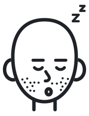

<picture>
  <source media="(prefers-color-scheme: dark)" srcset="faces/asleep-dark.svg">
  
</picture>

### G'day, I'm Dale 👋

I build things in mostly Rust these days.

- 🌀 **[maze.do.id.au](https://maze.do.id.au)**: mazes on squares, hexagons and beyond
- 🌐 **[daleobrien.github.io](https://daleobrien.github.io)**: everything else

The face follows my sleep, live from my Apple Watch. [See it here](https://daleobrien.github.io/sleep/).
